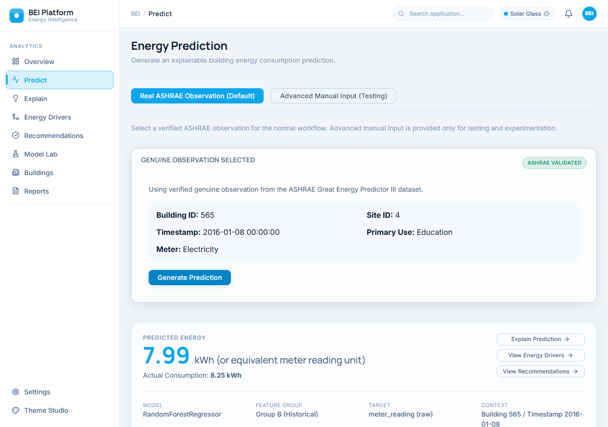
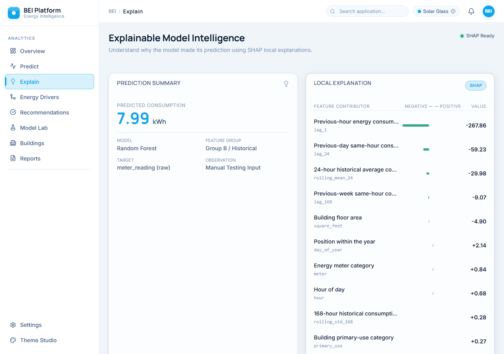

# Explainable Machine Learning for Building Energy Consumption Prediction

An end-to-end building energy prediction system using machine learning and SHAP for explainable, data-driven efficiency optimization.

[](https://python.org)
[](https://fastapi.tiangolo.com/)
[](https://react.dev)
[](LICENSE)

[Quick Start](#quick-start) • [Architecture](#approach) • [Research](#research)



## Overview

This project provides facility managers with a localized, data-driven approach to predicting and optimizing building energy consumption. By training regression models on historical meter and weather data, the system predicts energy demand and leverages TreeSHAP to explain precisely which factors are driving that demand. A recommendation engine translates these mathematical explanations into practical operational advice.

## Why this project

Building energy usage accounts for a significant portion of global energy consumption. Facility managers often struggle to accurately forecast usage or identify the root causes of inefficiency, relying instead on static schedules or intuition. 

Existing analytical models frequently act as "black boxes." If a model predicts an unusual energy spike, operators cannot blindly act without understanding *why*. This project solves the transparency problem by wrapping a high-accuracy predictive model in an explainable AI framework, directly exposing actionable drivers in a human-readable interface.

## Approach

**Conceptual Pipeline:**

ASHRAE Data → Preprocessing → Feature Engineering → ML Models → Prediction → SHAP Explanation → Energy Drivers → Recommendations → Decision Support

For detailed system design and API routing, see [APPLICATION_ARCHITECTURE.md](docs/APPLICATION_ARCHITECTURE.md).

## Results

The final production model is a **Random Forest** regression model, selected after evaluating multiple algorithms (including LightGBM and Linear Regression) on a rigorous temporal holdout set (December 2016).

**Final Holdout Performance:**
- **MAE:** 34.36
- **RMSE:** 175.65
- **R²:** 0.9876

These results reflect the model's performance on unseen test data from the original experimental pipeline.

## Application



The application provides a unified interface for prediction and explainability:
- **Prediction:** Select a building (e.g., Building 565) and provide a feature set to forecast energy usage.
- **Explainability:** View global and local SHAP attributions to understand which temporal or weather features are increasing or decreasing the predicted load.
- **Recommendations:** Receive targeted operational strategies (e.g., HVAC load shifting) based on the top driving features.

## Quick Start

Ensure you have Python 3.9+ and Node.js 18+ installed. 

**First-time setup:**
Double-click `SETUP_BEI.bat`
*(This creates the virtual environment, installs dependencies, and builds the React frontend production assets.)*

**Normal launch:**
Double-click `START_BEI.bat`
*(This starts the FastAPI backend server and automatically opens your browser to the local application.)*

**Shutdown:**
Double-click `STOP_BEI.bat`

## Repository Structure

```
.
├── app/                  # FastAPI backend and React frontend source
├── docs/                 # Documentation (Architecture, Schema, XAI)
├── models/               # Serialized final models and preprocessors
├── notebooks/            # Exploratory data analysis and model training
├── reports/              # Final experiment results and evaluation logs
├── tests/                # Automated backend test suite
├── README.md             # Project overview
└── *.bat                 # Windows application launcher scripts
```

## Research

This codebase accompanies a formal undergraduate research project. Detailed methodology, data cleaning decisions, and SHAP analyses are documented within the repository.
- [XAI Methodology](docs/XAI_METHOD.md)
- [Recommendation Rules](docs/RECOMMENDATION_ENGINE.md)
- [Master Experimental Results](docs/MASTER_EXPERIMENTAL_RESULTS.md)

## Limitations

- Forecasts rely heavily on historical usage trends; the model is not designed for "cold-start" prediction on newly constructed buildings with no historical data.
- The model is trained exclusively on the ASHRAE Great Energy Predictor III dataset. Geographic generalization to unrepresented climate zones requires retraining.

## License

This project is licensed under the MIT License. See the [LICENSE](LICENSE) file for details.
