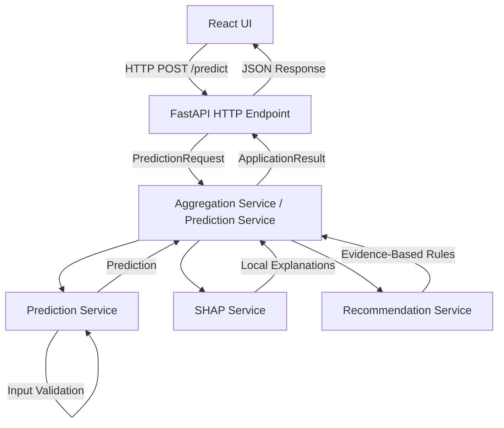

# Application Architecture

## 1. Purpose
The application backend serves as a clean, UI-agnostic service layer that safely exposes the underlying validated machine learning pipeline. It strictly prevents unauthorized model alterations, preserves non-causal SHAP constraints, and enforces necessary data input boundaries (specifically regarding historical autoregressive features).

## 2. Architecture
The architecture follows a decoupled service pattern where each module holds a single responsibility:
- **Schemas**: Strict data models for request and response APIs.
- **Model Service**: Centralized Singleton loading of heavy Random Forest artifacts.
- **Prediction Service**: Manages feature validation and inference mapping.
- **SHAP Service**: Isolates explainability extraction using `TreeExplainer`.
- **Recommendation Service**: Integrates the Phase 10 rule-engine.
- **Aggregation Service**: Orchestrates all services to return a unified `ApplicationResult`.

## 3. Module Responsibilities
- `app/schemas/api_models.py`: Dataclass definitions defining I/O.
- `app/services/model_service.py`: Caches `final_random_forest_raw_group_b.joblib`, preprocessor, and JSON schema.
- `app/services/prediction_service.py`: Prevents invalid feature structures or missing historical values from reaching the model.
- `app/services/shap_service.py`: Computes local SHAP attributions and organizes features into historical, temporal, and weather drivers.
- `app/services/recommendation_service.py`: Converts numeric SHAP drivers into human-readable actions using predefined rules.
- `app/services/aggregation_service.py`: Generates the final end-to-end response payload.

## 4. Data Flow

## 5. Model Artifact Flow
To prevent massive memory overhead, the 200-tree Random Forest is loaded exactly once by the `ModelService` Singleton during application startup. Any subsequent prediction request retrieves the active memory reference rather than repeatedly reading from disk.

## 6. SHAP Flow
The SHAP Service bypasses full recomputation by loading `reports/tables/shap_global_importance.csv` once for global context. For individual predictions, it calculates *only* the specific local explanation matrix using the exact single row processed by the `TreeExplainer`.

## 7. Recommendation Flow
Recommendations are fully sandboxed. The application feeds the local SHAP dictionary into the validated Phase 10 engine. The UI receives only the structured output strings and non-causal disclaimers, inherently preventing the UI from accidentally hallucinating arbitrary energy-saving percentages.

## 8. Historical-Input Constraint (MODE A / B)
The validated ML model fundamentally relies on Group B autoregressive features. 
- **MODE A (History Available)**: If a building passes actual telemetry (`lag_1`, `rolling_mean_24`), inference proceeds natively.
- **MODE B (History Unavailable)**: The `PredictionService` explicitly detects missing historical inputs and fails cleanly with an `insufficient_history` status. It does NOT attempt to fabricate moving averages or lag values. External buildings without telemetry cannot be scored by this specific iteration of the model.

## 9. Error Handling
- Invalid/missing inputs trigger structured API rejections (`missing_features`, `invalid_numerical_input`).
- Model absence raises critical startup exceptions.
- Graceful degradation: If SHAP generation fails internally, the API returns the prediction alongside an empty explanation rather than a hard crash.

## 10. Testing Strategy
Backend functions are rigorously validated via unit testing (`tests/test_app_backend.py`). Tests ensure correct dependency injection, payload schematics, strict adherence to MODE B constraints, and successful orchestration.

## 11. UI Integration Boundary
The architecture is decoupled from frontend technology. The React Vite application communicates with the backend via the FastAPI HTTP interface (`app/main.py`), utilizing development endpoints such as `GET /health`, `GET /model-info`, and `POST /predict`. The frontend constructs a JSON `PredictionRequest` dictionary and consumes the JSON response safely.

## 12. Known Limitations
- The application does not dynamically retrain the model.
- Time-series inputs (`timestamp`) must be pre-parsed into cyclical encoding features (`hour_cos`, `day_of_week`) before striking the prediction endpoint, matching the required schema.
